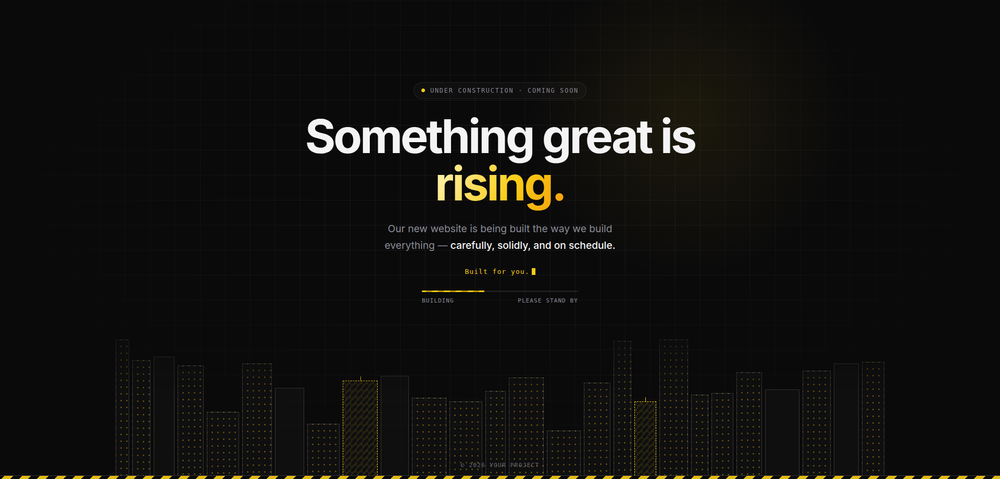

# Blueprint Coming Soon

A minimalist, single-file **"Under Construction / Coming Soon"** page with a blueprint grid, an animated skyline, and a loading bar. Zero dependencies, no build step. Drop in `index.html` and deploy anywhere.

<!-- Add a screenshot:  -->

## Features

- **One file.** Everything lives in `index.html` (HTML, CSS, and vanilla JS).
- **Construction theme.** Blueprint grid, skyline that rises building by building, two buildings still "under construction", and a hazard stripe.
- **Typed tagline.** Rotating phrases with a blinking cursor.
- **Indeterminate loading bar.** No fake progress numbers.
- **Cursor glow.** A subtle light that follows the pointer.
- **Responsive.** Works on phones, tablets, and desktops.
- **Accessible motion.** Respects `prefers-reduced-motion`.
- **Zero dependencies.** No frameworks, no external fonts, no CDN calls.

## Quick start

1. Download or clone this repo.
2. Open `index.html` in your browser to preview it.
3. Edit the text and colors (see below).
4. Deploy (see [Deploy](#deploy)).

## Customize

### Text

Search `index.html` for the placeholders and replace them with your own:

| What | Where |
| --- | --- |
| Browser tab title | `<title>` |
| Search / share description | `<meta name="description">`, `og:title`, `og:description`, `og:url` |
| Badge text | `.pill` (default: `Under Construction · Coming Soon`) |
| Headline | `<h1>`. The word inside `<em>` gets the accent gradient |
| Intro paragraph | `<p class="lead">` |
| Rotating phrases | `phrases` array in the `<script>` |
| Loading bar labels | `.meta` spans (default: `BUILDING` / `PLEASE STAND BY`) |
| Footer | `<footer>` (replace `[Your Brand]`) |

### Colors

All colors are CSS variables at the top of the `<style>` block:

```css
:root {
  --bg: #0a0a0b;      /* background */
  --fg: #f4f4f5;      /* main text */
  --muted: #8a8a93;   /* secondary text */
  --accent: #facc15;  /* safety yellow; change this to rebrand */
  --line: rgba(255,255,255,.08);
}
```

If you change `--accent`, also update the matching `rgba(250,204,21, …)` values (window dots, glow, pulse) and the favicon's `stroke` color so everything stays consistent.

### Skyline

In the `<script>` block:

```js
const COUNT = 26;              // number of buildings
const wipIdx = new Set([8, 17]); // which buildings are still "under construction"
let seed = 7;                  // change to get a different skyline layout
```

### Favicon

The favicon is an inline SVG in the `<link rel="icon">` tag. Replace it with your own file (e.g. `<link rel="icon" href="/favicon.ico">`) if you prefer.

## Deploy

It's a static page, so any static host works.

**Cloudflare Pages (Direct Upload)**
1. Dashboard → Workers & Pages → Create → Pages → Upload assets.
2. Drag in the folder containing `index.html` → Deploy.
3. Add your domain under Custom domains.

**GitHub Pages**
1. Push to GitHub.
2. Settings → Pages → Deploy from branch → `main` / root.

**Netlify**
Drag the folder onto [app.netlify.com/drop](https://app.netlify.com/drop).

**Vercel**
Import the repo. No framework preset or build command needed.

## Browser support

Any modern browser (Chrome, Edge, Firefox, Safari). Uses CSS variables, `mask-image`, and `background-clip: text`.

## License

[MIT](LICENSE). Free to use, modify, and distribute, including for client work.
